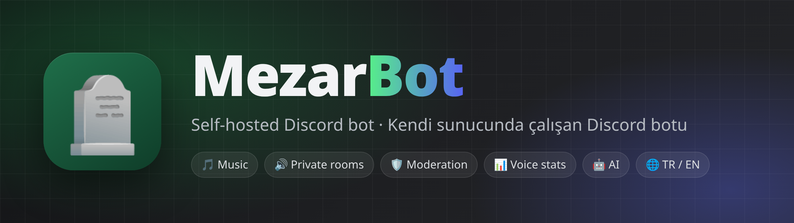
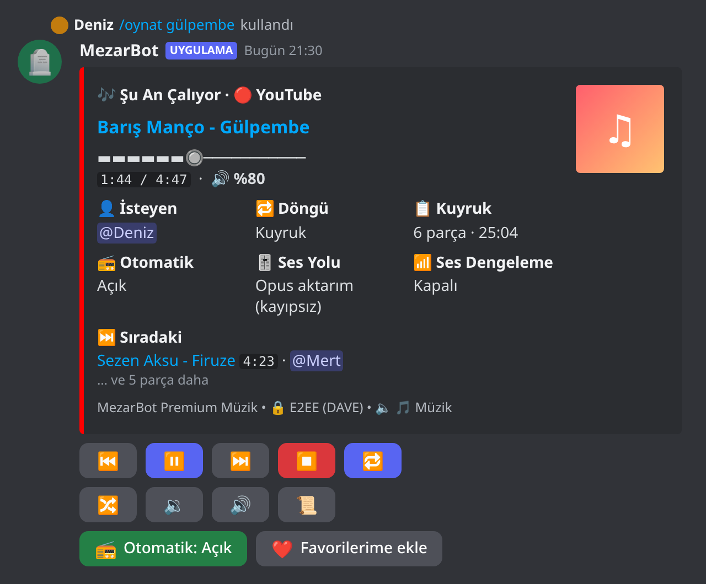
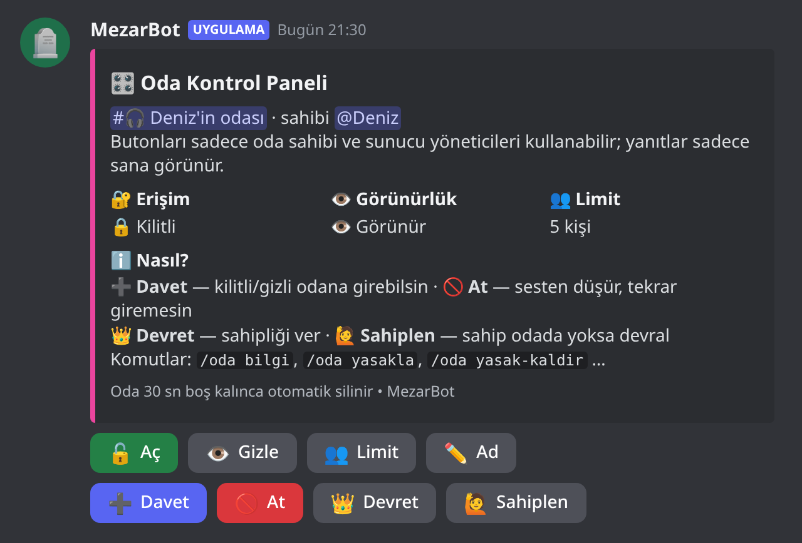
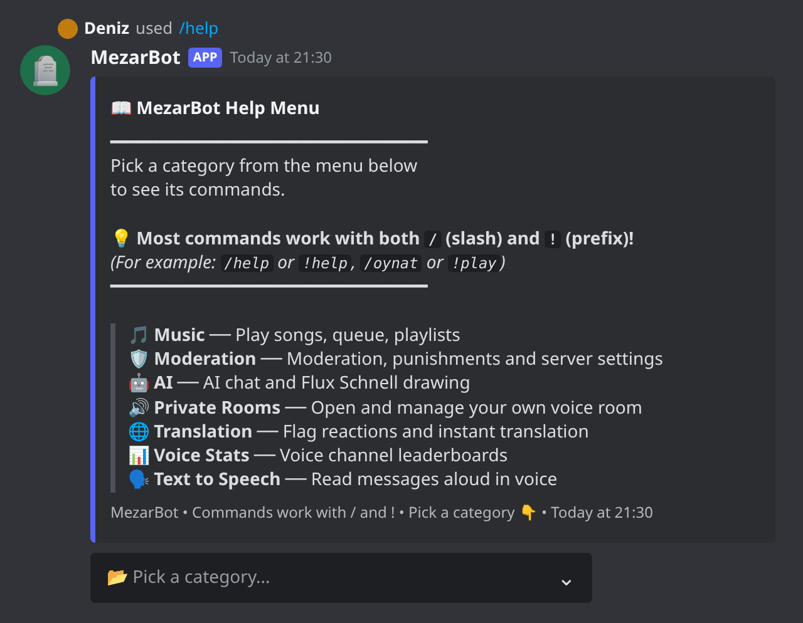
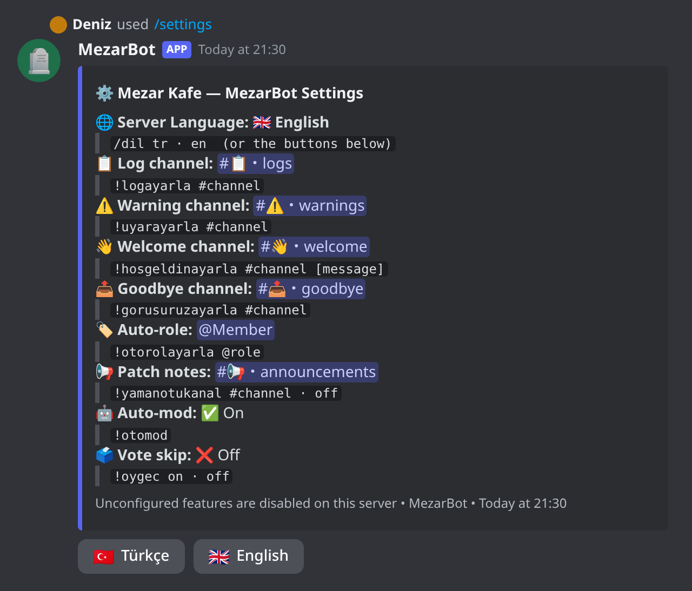
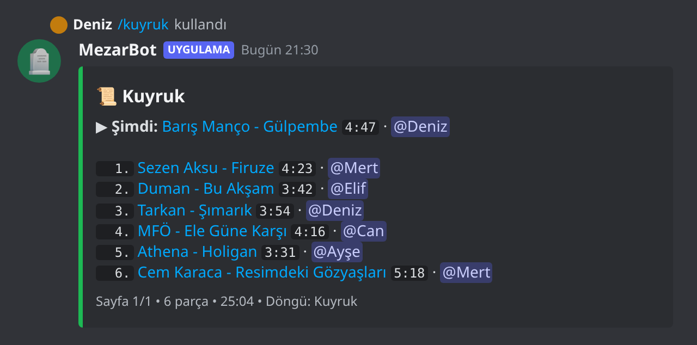
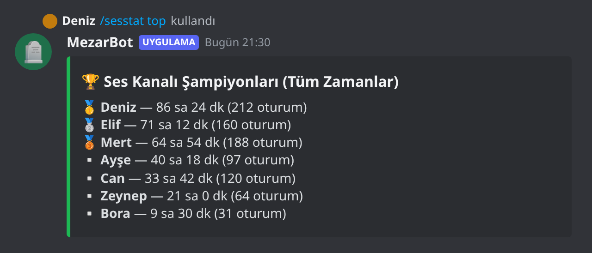
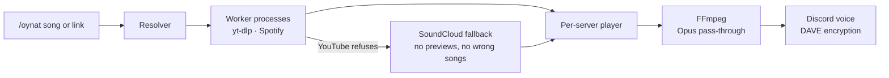
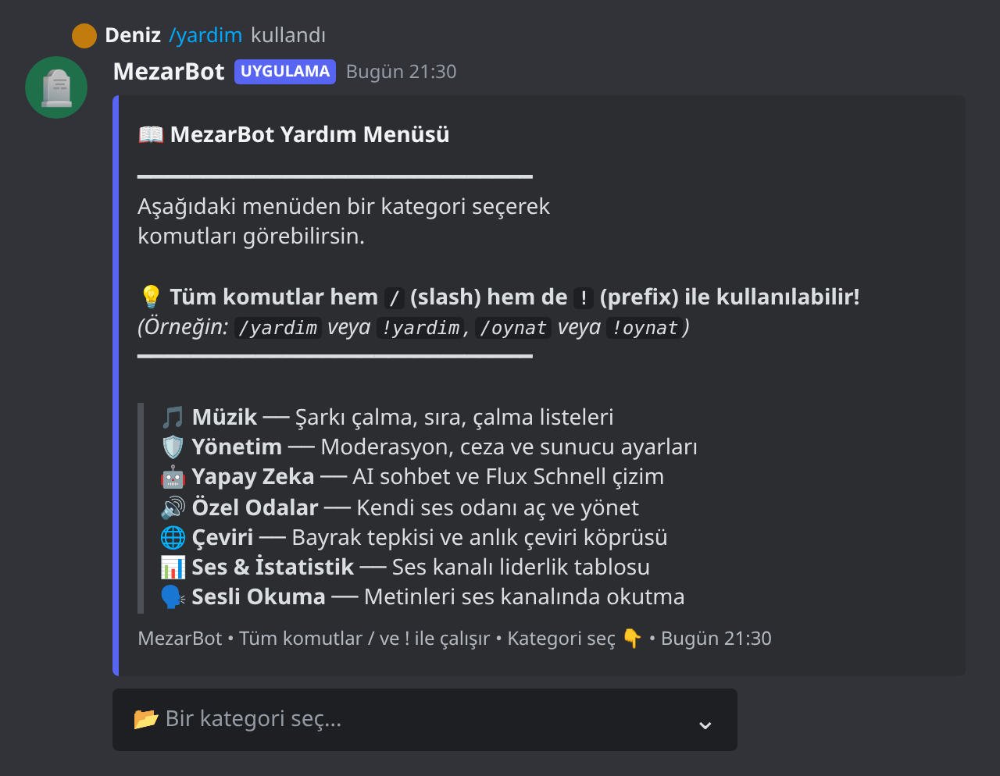
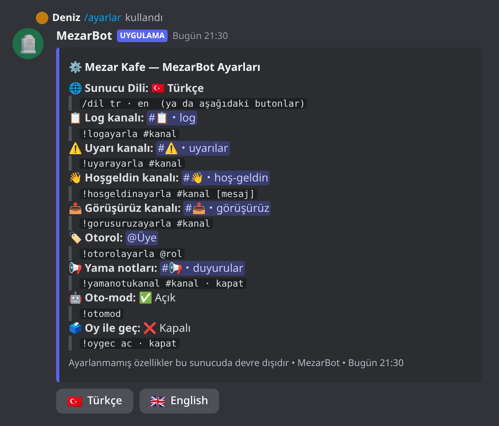

<div align="center">



<br>

[](https://github.com/kutyfuty/mezarbot/actions/workflows/test.yml)
[](#-setup)
[](https://github.com/Rapptz/discord.py)
[](#-setup)
[](LICENSE)
[](https://github.com/kutyfuty/mezarbot/stargazers)

**A self-hosted, multi-server Discord bot: stutter-free music, private voice rooms, moderation, voice stats and AI.**

**English** · [Türkçe](#-türkçe)

[Features](#-features) · [Screenshots](#-screenshots) · [Setup](#-setup) · [Commands](KOMUTLAR.md) · [How the music works](#-how-the-music-works)

</div>

---

## ✨ Features

<table>
<tr>
<td width="50%" valign="top">

### 🎵 Music that doesn't stutter
YouTube, YouTube Music, Spotify, SoundCloud and direct links. Persistent button panel, queue, loop, seek,
vote skip, DJ role, autoplay, 24/7 mode, request channel, playlists and synced lyrics.

</td>
<td width="50%" valign="top">

### 🛟 SoundCloud fallback
YouTube blocked a song (bot check, age or region lock, removed video)? The bot finds the same song on SoundCloud,
skipping 30-second previews and wrong matches like covers and remixes.

</td>
</tr>
<tr>
<td valign="top">

### 🔊 Private voice rooms
One click creates your own room. Lock, hide, invite, kick, ban, set a limit, rename, transfer or claim it from a
button panel. Empty rooms clean themselves up.

</td>
<td valign="top">

### 🛡️ Moderation
Flood auto-mod, warnings, timeout / kick / ban, message and moderation logs, welcome and goodbye messages,
auto-role, AFK and a random team builder.

</td>
</tr>
<tr>
<td valign="top">

### 📊 Voice stats
Weekly, monthly and all-time leaderboards of who spends the most time in voice channels.

</td>
<td valign="top">

### 🤖 AI, TTS and translation
Mention the bot to chat (Groq, free tier), generate images with `/draw`, read text aloud with `/konus`, and react
with 🇬🇧 / 🇹🇷 to translate any message.

</td>
</tr>
</table>

Every feature works per server, and each server picks its own language (Turkish or English). Optional features
whose API key is missing simply turn off instead of crashing the bot.

## 📸 Screenshots

<div align="center">
<table>
<tr>
<td align="center"><br><sub><b>Music panel</b></sub></td>
<td align="center"><br><sub><b>Private room panel</b></sub></td>
</tr>
<tr>
<td align="center"><br><sub><b>Help menu</b></sub></td>
<td align="center"><br><sub><b>Server settings</b></sub></td>
</tr>
<tr>
<td align="center"><br><sub><b>Queue</b></sub></td>
<td align="center"><br><sub><b>Voice leaderboard</b></sub></td>
</tr>
</table>
</div>

<sub>Rendered from the bot's real embed and button output with sample users (<code>docs/ekran/</code>). The help menu and
settings follow the server language; the music and room panels are Turkish for now.</sub>

## 🚀 Setup

**1. Create the bot.** In the [Discord Developer Portal](https://discord.com/developers/applications): New Application →
Bot → copy the token. Turn on the **Server Members** and **Message Content** intents. Invite it with OAuth2 → URL
Generator (`bot` + `applications.commands`, Administrator or the permissions you need).

**2. Configure.**
```bash
git clone https://github.com/kutyfuty/mezarbot.git && cd mezarbot
cp .env.example .env                 # DISCORD_TOKEN is required, the rest is optional
cp config.example.json config.json   # set sahip_id to your Discord user ID
```

**3. Run.**

<details open>
<summary><b>🐳 Docker (recommended)</b></summary>

```bash
docker compose up -d --build
docker compose logs -f
```
The database and caches live in `./data`.
</details>

<details>
<summary><b>🐍 Without Docker</b></summary>

Needs Python 3.11+ (tested on 3.14), FFmpeg, and Deno ≥ 2.3 or Node ≥ 22 (for YouTube).
```bash
python3 -m venv venv
venv/bin/pip install -r requirements.txt
venv/bin/python main.py
```
For a Linux service, see [`deploy/mezarbot.service.example`](deploy/mezarbot.service.example).
</details>

<details>
<summary><b>🔑 Environment variables</b></summary>

| Variable | Required | Used for |
|---|:---:|---|
| `DISCORD_TOKEN` | ✅ | Bot token |
| `GROQ_API_KEY` | | AI chat and translation ([free](https://console.groq.com)) |
| `REPLICATE_API_TOKEN` | | `/draw` image generation |
| `SPOTIFY_CLIENT_ID` / `SPOTIFY_CLIENT_SECRET` | | Spotify API (falls back to the public embed page) |
</details>

**4. On your server:** `/dil en` (or `!language en`) switches to English, `/settings` sets up logs, welcome and
auto-role, `/ozelodaaktif` creates the private room system, and `/muzikayar` sets the DJ role, request channel and 24/7 mode.

## 🎧 How the music works



Resolving runs in separate processes, so heavy yt-dlp work never blocks the audio thread. Opus sources go to Discord
without re-encoding, and the next song is resolved while the current one plays.

## 🧪 Tests

```bash
venv/bin/python tests/smoke_test.py            # database, migrations, multi-server behavior
venv/bin/python tests/ozel_oda_test.py         # private voice rooms
venv/bin/python tests/muzik_test.py --agsiz    # music, offline (drop the flag to test real streams)
```
Tests never connect to Discord or touch your real database, and they run on every push.

## 📝 Notes

- The code and bot messages are in Turkish. Architecture and rules are in [AGENTS.md](AGENTS.md).
- Modules in `cogs_devre_disi/` (economy, confessions, word game, …) are not loaded by default.
- On a VPS, YouTube often asks for bot verification. A `data/cookies.txt` (Netscape format) helps, and the SoundCloud
  fallback covers the rest.
- Music works through yt-dlp; follow the terms of the platforms you use.

<div align="center">

**If MezarBot is useful to you, a ⭐ helps a lot.**

</div>

---

<div align="center">

## 🇹🇷 Türkçe

**Kendi sunucunda çalışan, çok sunuculu Discord botu: takılmayan müzik, özel ses odaları, moderasyon, ses istatistikleri ve yapay zekâ.**

[English](#-features) · **Türkçe**

</div>

### ✨ Özellikler

<table>
<tr>
<td width="50%" valign="top">

#### 🎵 Takılmayan müzik
YouTube, YouTube Music, Spotify, SoundCloud ve doğrudan linkler. Kalıcı butonlu panel, kuyruk, döngü, sarma,
oylamalı atlama, DJ rolü, otomatik oynatma, 7/24 modu, istek kanalı, çalma listeleri ve senkron sözler.

</td>
<td width="50%" valign="top">

#### 🛟 SoundCloud yedeği
YouTube bir şarkıyı çalmadı mı (bot doğrulaması, yaş/bölge kısıtı, kaldırılmış video)? Bot aynı şarkıyı SoundCloud'da
bulur; 30 sn'lik önizlemeleri ve cover, remix gibi yanlış eşleşmeleri atlar.

</td>
</tr>
<tr>
<td valign="top">

#### 🔊 Özel ses odaları
Tek tıkla kendi odan. Butonlu panelden kilitle, gizle, davet et, at, yasakla, limit koy, adını değiştir, devret ya da
sahiplen. Boş kalan odalar kendiliğinden silinir.

</td>
<td valign="top">

#### 🛡️ Moderasyon
Flood oto-modu, uyarılar, susturma / atma / yasaklama, mesaj ve moderasyon logları, hoş geldin ve görüşürüz mesajları,
otomatik rol, AFK ve rastgele takım kurma.

</td>
</tr>
<tr>
<td valign="top">

#### 📊 Ses istatistikleri
Ses kanallarında en çok vakit geçirenlerin haftalık, aylık ve tüm zamanlar sıralaması.

</td>
<td valign="top">

#### 🤖 Yapay zekâ, seslendirme ve çeviri
Botu etiketleyerek sohbet (Groq, ücretsiz), `/ciz` ile resim, `/konus` ile sesli okuma; herhangi bir mesaja 🇬🇧 / 🇹🇷
tepkisi koyarak çeviri.

</td>
</tr>
</table>

Her özellik sunucu bazında çalışır ve her sunucu kendi dilini seçer (Türkçe ya da İngilizce). API anahtarı olmayan
özellikler botu çökertmek yerine kapanır.

### 📸 Ekran görüntüleri

<div align="center">
<table>
<tr>
<td align="center"><br><sub><b>Müzik paneli</b></sub></td>
<td align="center"><br><sub><b>Özel oda paneli</b></sub></td>
</tr>
<tr>
<td align="center"><br><sub><b>Yardım menüsü</b></sub></td>
<td align="center"><br><sub><b>Sunucu ayarları</b></sub></td>
</tr>
<tr>
<td align="center"><br><sub><b>Kuyruk</b></sub></td>
<td align="center"><br><sub><b>Ses sıralaması</b></sub></td>
</tr>
</table>
</div>

<sub>Görseller botun gerçek embed ve buton çıktısından, örnek kullanıcılarla üretildi (<code>docs/ekran/</code>).</sub>

### 🚀 Kurulum

**1. Botu oluştur.** [Discord Developer Portal](https://discord.com/developers/applications) → New Application → Bot →
token'ı kopyala. **Server Members** ve **Message Content** intent'lerini aç. OAuth2 → URL Generator ile davet et
(`bot` + `applications.commands`, Administrator ya da gereken izinler).

**2. Ayarla.**
```bash
git clone https://github.com/kutyfuty/mezarbot.git && cd mezarbot
cp .env.example .env                 # DISCORD_TOKEN zorunlu, diğerleri opsiyonel
cp config.example.json config.json   # sahip_id = kendi Discord kullanıcı ID'n
```

**3. Çalıştır.**

<details open>
<summary><b>🐳 Docker ile (önerilen)</b></summary>

```bash
docker compose up -d --build
docker compose logs -f
```
Veritabanı ve önbellek `./data` klasöründe kalır.
</details>

<details>
<summary><b>🐍 Docker olmadan</b></summary>

Python 3.11+ (3.14 ile test edildi), FFmpeg ve YouTube için Deno ≥ 2.3 ya da Node ≥ 22 gerekir.
```bash
python3 -m venv venv
venv/bin/pip install -r requirements.txt
venv/bin/python main.py
```
Linux servisi için: [`deploy/mezarbot.service.example`](deploy/mezarbot.service.example).
</details>

<details>
<summary><b>🔑 Ortam değişkenleri</b></summary>

| Değişken | Gerekli | Ne için |
|---|:---:|---|
| `DISCORD_TOKEN` | ✅ | Bot token'ı |
| `GROQ_API_KEY` | | Yapay zekâ sohbeti ve çeviri ([ücretsiz](https://console.groq.com)) |
| `REPLICATE_API_TOKEN` | | `/ciz` resim çizimi |
| `SPOTIFY_CLIENT_ID` / `SPOTIFY_CLIENT_SECRET` | | Spotify API (yoksa herkese açık embed sayfası kullanılır) |
</details>

**4. Sunucunda:** `/dil` → botun dili, `/ayarlar` → log, hoş geldin, otorol; `/ozelodaaktif` → özel ses odaları;
`/muzikayar` → DJ rolü, istek kanalı, 7/24 modu. Tüm komutlar: [KOMUTLAR.md](KOMUTLAR.md).

### 🧪 Testler

```bash
venv/bin/python tests/smoke_test.py            # veritabanı, migrasyonlar, çok sunuculu davranış
venv/bin/python tests/ozel_oda_test.py         # özel ses odaları
venv/bin/python tests/muzik_test.py --agsiz    # müzik, ağsız (parametresiz: gerçek akış testleri de)
```
Testler Discord'a bağlanmaz, gerçek veritabanına dokunmaz ve her push'ta çalışır.

### 📝 Notlar

- Kod ve bot mesajları Türkçedir. Mimari ve kurallar: [AGENTS.md](AGENTS.md).
- `cogs_devre_disi/` içindeki modüller (ekonomi, itiraf, kelime oyunu …) varsayılan olarak yüklenmez.
- VPS'te YouTube sık sık bot doğrulaması ister. `data/cookies.txt` (Netscape biçimi) eklemek işe yarar; kalanını
  SoundCloud yedeği karşılar.
- Müzik yt-dlp ile çalışır; kullandığın platformların kurallarına uymak senin sorumluluğundadır.

<div align="center">

**MezarBot işine yaradıysa bir ⭐ çok destek olur.**

<sub>MIT lisanslı · <a href="LICENSE">LICENSE</a></sub>

</div>
